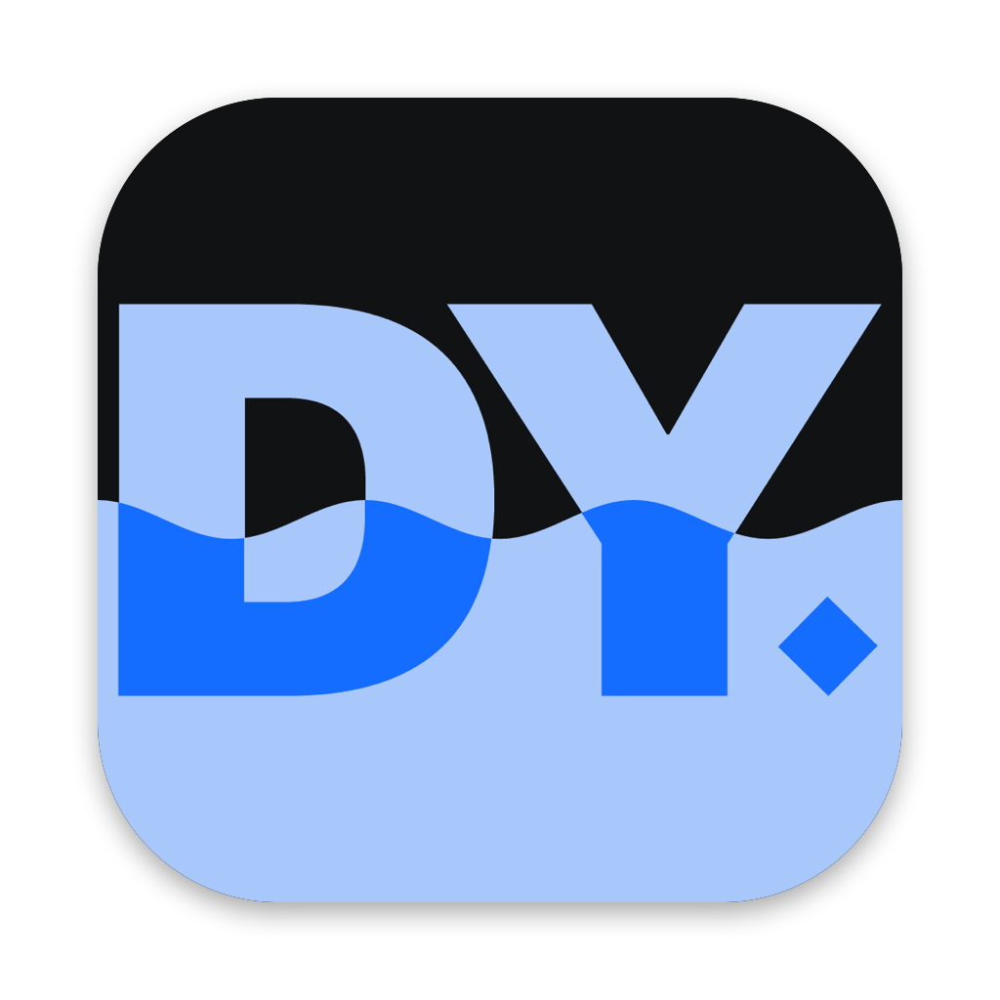
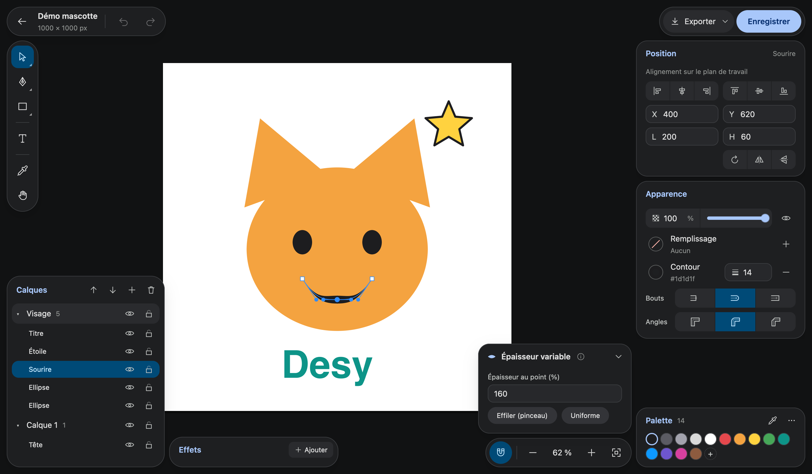

<div align="center">



# Desy

**Logiciel libre de dessin vectoriel pour créer des logos, des mascottes et des illustrations.**

Application native pour macOS, Linux et Windows, écrite en Rust avec [GPUI](https://gpui.rs), le framework GPU de Zed.

[](https://github.com/Sprowll/Desy/actions/workflows/ci.yml)
[](https://github.com/Sprowll/Desy/actions/workflows/security.yml)
[](https://github.com/Sprowll/Desy/releases/latest)
[](LICENSE.md)

[Télécharger](#télécharger) · [Fonctionnalités](#fonctionnalités) · [Raccourcis](#raccourcis) · [Compiler](#compiler-depuis-les-sources) · [Contribuer](CONTRIBUTING.md)



</div>

## Pourquoi Desy ?

Desy est pensé pour une chose : dessiner des **logos et des mascottes** vite, dans l'esprit d'Illustrator et de Figma, sans abonnement ni compte en ligne. Le canvas occupe toute la fenêtre, les outils flottent par-dessus (style Material 3), et tout reste vectoriel jusqu'à l'export.

- **Rapide** : rendu GPU natif, pas de navigateur ni d'Electron.
- **Hors ligne** : tes projets sont des fichiers `.desy` (JSON) dans `~/Documents/Desy`.
- **Non destructif** : symétrie, effets et formes paramétriques restent modifiables jusqu'à ce que tu les appliques.

## Télécharger

Les versions compilées sont publiées sur la page [**Releases**](https://github.com/Sprowll/Desy/releases/latest) :

| Système | Fichier |
|---|---|
| macOS (Apple Silicon) | `Desy-<version>-macos-arm64.dmg` |
| macOS (Intel) | `Desy-<version>-macos-x86_64.dmg` |
| Linux x86_64 | `desy-<version>-linux-x86_64.tar.gz` |
| Windows x86_64 | `desy-<version>-windows-x86_64.zip` |

Chaque release contient un fichier `SHA256SUMS.txt` et une [attestation de provenance](https://docs.github.com/actions/security-guides/using-artifact-attestations) signée par GitHub. Pour vérifier qu'un fichier a bien été produit par ce dépôt :

```sh
gh attestation verify Desy-0.1.0-macos-arm64.dmg --repo Sprowll/Desy
```

> [!NOTE]
> **macOS** : l'app n'est pas encore notarisée par Apple. Au premier lancement, fais un clic droit sur Desy → **Ouvrir**, ou va dans *Réglages Système → Confidentialité et sécurité → Ouvrir quand même*.
>
> **Linux** : décompresse l'archive et lance `./desy`. Pour l'ajouter au menu des applications, copie `desy.desktop` dans `~/.local/share/applications/` et `desy.png` dans `~/.local/share/icons/`.

### Mises à jour

Au lancement, Desy demande à GitHub quelle est la dernière version publiée. S'il en existe une plus récente, un bandeau **« Desy x.y.z est disponible »** apparaît sur l'écran d'accueil avec un bouton vers la page de téléchargement. Rien n'est installé sans ton accord et aucune donnée personnelle n'est envoyée (une seule requête anonyme à l'API publique de GitHub).

Pour désactiver cette vérification : lancer Desy avec la variable d'environnement `DESY_NO_UPDATE_CHECK=1`.

## Fonctionnalités

### Dessin

- **Formes** : rectangle (coins arrondis, ensemble ou indépendants), ellipse, polygone, étoile, ligne.
- **Formes organiques** : **Blob** (forme arrondie irrégulière, nombre de points, irrégularité, « Nouvelle forme ») et **Vague** (ligne ondulée ou vague remplie). Elles restent paramétriques et se convertissent en tracé.
- **Tracés** : plume (points d'angle ou lisses, fermeture, prolongement), crayon à main levée lissé automatiquement, sélection directe des points et des poignées.
- **Épaisseur variable** : outil Largeur (W) pour épaissir un trait à un endroit précis, préréglage « Effiler (pinceau) ».
- **Texte** converti en contours vectoriels : polices système, **Adobe Fonts** (via Creative Cloud) et **Google Fonts** téléchargeables depuis l'app et utilisables hors ligne.
- **Images** : PNG, JPEG, WebP, GIF, BMP par glisser-déposer ou ⌘I, intégrées au projet. **Références** de décalque verrouillées à 40 % d'opacité, jamais exportées.

### Symétrie et effets en direct

- **Symétrie de calque** (comme le modificateur Miroir de Blender) : tu dessines une moitié de la mascotte, l'autre suit. Les extrémités posées sur l'axe fusionnent en un tracé continu.
- **Pile d'effets** non destructive, dans l'esprit de Blender ou du menu Effet d'Illustrator :
  - *Déformer* : contracter et dilater, tourbillon, rugosité, zigzag ;
  - *Transformer* : transformation avec copies (rosaces), décalage du contour (effet autocollant) ;
  - *Rendu* : ombre portée, ombre interne, lueurs externe et interne, flou, bruit.
- **Dégradés** linéaires et radiaux.
- **Booléens** qui conservent les courbes : union, soustraction, intersection, exclusion (aussi sur les traits et le texte).

### Couleur

- **Palette du projet** (dans l'esprit d'Aseprite et Canva) : préréglages, import `.gpl` / `.hex` / `.txt` (GIMP, Lospec, Paint.NET), export `.gpl`, « Couleurs du document ».
- **Sélecteur** TSL + opacité, hexadécimal, nuancier.
- **Pipette** sur les contours, remplissages, pixels d'images et fond.

### Mise en page et productivité

- **Calques** : visibilité, verrouillage, renommage, ordre.
- **Repères magnétiques** sur les bords et centres des objets et du plan de travail.
- **Barre rapide** au-dessus de la sélection (couleurs, contour, arrondi, transparence, effets, position, miroir).
- Alignement, rotation, miroir, duplication, copier/coller, annuler/rétablir illimité, menu contextuel complet.
- **Projets** : écran d'accueil avec miniatures, formats prêts à l'emploi (logo, icône, mascotte, bannière, carte de visite).

### Export

- **SVG** (dégradés et filtres inclus), **PNG** (transparent) et **JPG**, à la taille du document.

## Raccourcis

| Outil | Touche | | Action | Raccourci |
|---|---|---|---|---|
| Sélection | V | | Annuler / Rétablir | ⌘Z / ⇧⌘Z |
| Sélection directe | A | | Enregistrer / sous | ⌘S / ⇧⌘S |
| Plume | P | | Exporter en SVG | ⌘E |
| Crayon | N | | Dupliquer | ⌘D |
| Largeur | W | | Union / Soustraire | ⌥⌘U / ⌥⌘S |
| Ligne | L | | Intersection / Exclusion | ⌥⌘I / ⌥⌘X |
| Rectangle | M ou R | | Premier plan / Avancer | ⇧⌘] / ⌘] |
| Ellipse | E ou O | | Ajuster / 100 % | ⌘0 / ⌘1 |
| Polygone | Y | | Zoom | ⌘ + molette, pincement |
| Étoile | S | | Déplacer la vue | molette, Espace + glisser |
| Blob | B | | Magnétisme on/off | ⌘; |
| Vague | U | | Importer une image | ⌘I |
| Texte | T | | Miroir ↔ / ↕ | ⇧H / ⇧V |
| Pipette | I | | Retour aux projets | ⌘W |
| Symétrie | X | | | |
| Main | H | | | |

Sur Linux et Windows, ⌘ = Ctrl.

## Compiler depuis les sources

Il faut [Rust](https://rustup.rs) stable (édition 2024).

```sh
git clone https://github.com/Sprowll/Desy.git
cd Desy
cargo run --release
```

- **macOS** : les Command Line Tools suffisent (pas besoin de Xcode complet).
- **Linux** (Debian/Ubuntu) :
  `sudo apt install libxkbcommon-dev libxkbcommon-x11-dev libwayland-dev libvulkan-dev libx11-xcb-dev libxcb1-dev libfontconfig-dev libfreetype-dev`
- **Windows** : toolchain MSVC.

Application macOS avec son icône : `cargo install cargo-bundle` puis `cargo bundle --release -p desy` (produit `target/release/bundle/osx/Desy.app`).

### Tests et vérifications

```sh
cargo test --workspace               # tests (réseau Google Fonts : cargo test -p desy -- --ignored)
cargo clippy --workspace --all-targets
cargo fmt --all --check
cargo deny --all-features check      # vulnérabilités et licences des dépendances
```

Capture de l'interface sans écran (développement) :
`DESY_SHOT=/tmp/shot.png DESY_SCENE=editor cargo run --features dev-screenshot`
(`DESY_MENU=2` ouvre le menu d'un groupe d'outils, `DESY_SELECT=effects` montre un exemple de chaque effet de forme, `DESY_SELECT=render` les dégradés et les effets de rendu, `DESY_FXMENU=1` ouvre le menu « Ajouter » des effets, `DESY_QUICK=stroke|radius|opacity|effects|position` ouvre un menu de la barre rapide).

## Architecture

```
crates/
  desy-core/    modèle et géométrie, sans interface (testé)
    document.rs   projet, calques, objets, formes, booléens sur la sélection
    path.rs       tracés éditables : points, poignées, largeur par point
    effects.rs    effets en direct : déformations, transformation, décalage, rendu
    stroke.rs     contours uniformes (kurbo) et à épaisseur variable
    boolean.rs    opérations booléennes sur courbes (linesweeper)
    snap.rs       repères magnétiques
    text.rs       polices (fontdb) → contours (ttf-parser), dossiers Adobe/Google
    svg.rs        export SVG (dégradés, filtres des effets de rendu)
    palette.rs    palettes : préréglages, lecture .gpl/.hex/.txt, export .gpl
    history.rs    annuler/rétablir
  desy-app/     application GPUI
    editor.rs     état de l'éditeur et interactions des outils (testé)
    canvas.rs     rendu du document et des surcouches, souris/trackpad
    view.rs       fenêtre d'édition (barres flottantes, rail d'outils), actions, fichiers
    panels.rs     propriétés et calques
    effects_panel.rs  pile d'effets
    palette_panel.rs  palette du projet
    quick_bar.rs  barre rapide au-dessus de la sélection
    export.rs     export SVG / PNG / JPG (rastérisation avec resvg)
    update.rs     vérification des nouvelles versions sur GitHub
    app.rs        écran d'accueil / projets
```

**Ajouter un effet** : une variante dans `EffectKind` et sa place dans `CATALOG` (`effects.rs`), ses curseurs dans `params` / `get` / `set` (`effects_panel.rs`), ses options non numériques dans `effect_options`. Un effet de rendu répond `true` à `is_render()`, déclare sa marge (`margin`) et son filtre SVG dans `write_filter` (`svg.rs`).

**Ajouter un outil** : une variante dans `Tool` (`editor.rs`) et sa place dans `Tool::GROUPS`, sa logique dans `mouse_down` / `mouse_move` / `mouse_up`, un raccourci dans `actions.rs`, une icône dans `icons.rs`.

## Feuille de route

Groupes, dégradés à plus de deux couleurs avec poignées sur le canvas, glisser-déposer dans les calques, édition du texte directement sur le canvas, repères d'espacement égal, règles et grilles, notarisation macOS.

## Contribuer

Les issues et pull requests sont les bienvenues : lis [CONTRIBUTING.md](CONTRIBUTING.md) avant de commencer. Pour signaler une faille de sécurité, suis [SECURITY.md](SECURITY.md) (pas d'issue publique).

## Licence

Desy est distribué sous la licence **[PolyForm Noncommercial 1.0.0](LICENSE.md)**. Le code source est public : tu peux le lire, l'utiliser, le modifier et le partager **à des fins non commerciales** (usage personnel, études, associations, enseignement, recherche…).

**Interdit sans accord écrit** : vendre Desy ou une version modifiée, l'intégrer à un produit ou service payant, ou l'utiliser dans un cadre commercial. Pour une licence commerciale, contacte l'auteur via [GitHub](https://github.com/RedginaldGodeau).

Les dessins que tu crées avec Desy t'appartiennent.

Le nom « Desy » et le logo DY. ne sont pas couverts par la licence du code : une version modifiée redistribuée doit porter un autre nom et un autre logo.

Required Notice: Copyright (c) 2026 Redginald Godeau (https://github.com/RedginaldGodeau)
